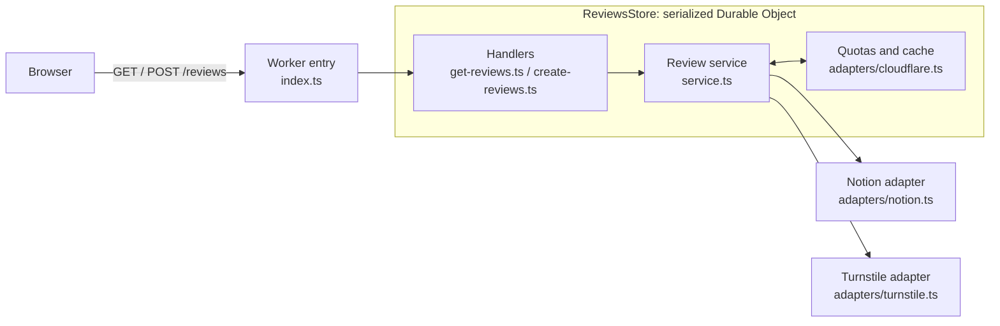

# Cookii backend

A Cloudflare Workers service for the Cookii website. It provides public API endpoints while keeping external-service credentials out of the browser. Stateful operations use SQLite-backed Durable Objects.

## Structure

```text
src/
  index.ts                 Worker entry point and composition
  config.ts                Cloudflare bindings and configuration checks
  diagnostics.ts           Structured events and request correlation
  reviews/
    model.ts               Review types, outcomes and validation functions
    ports.ts               Repository, verification and state interfaces
    service.ts             List/submit use cases; no HTTP or provider APIs
    http.ts                Bounded JSON parsing and response helpers
    submission.ts          Submission validation and token mapping
    handlers/
      index.ts             GET/POST dispatch
      get-reviews.ts       Read request handler
      create-reviews.ts    Write request handler
    adapters/
      notion.ts            Notion repository
      turnstile.ts         Challenge verification
      cloudflare.ts        Durable Object, persistent quotas and cache
scripts/deploy.ts          Deployment configuration and Wrangler runner
tests/
  reviews/                 Service and HTTP/adapter regression tests
  deployment/              Deployment tooling tests
```

Dependencies point toward the review model and ports. The service receives its adapters through interfaces; stateless parsing and validation use functions. HTTP responses stay in the handlers, HTTP helpers and Worker entry point. The Cloudflare adapter composes the service and serializes the entire use case, including quota reservation before external requests and the cache write afterward. Its object name and persistent storage keys remain stable.

The current `/reviews` endpoint supports GET (latest 20 reviews) and POST (submit a review). Turnstile verifies submissions before they are sent to Notion. The shared object persists quotas and a 60-second read cache.

## Reviews request flow



GET returns cached reviews or reads Notion. POST reserves quota and verifies Turnstile before creating a review. The Durable Object serializes quota reservations, external calls and cache updates.

## Local development

From the repository root:

```sh
npm ci --prefix backend
cp backend/.env.example backend/.dev.vars
```

The template is named `.env.example` for consistency; Wrangler reads the copied `.dev.vars` file locally. Fill in `.dev.vars` with credentials for a development Notion integration, a separate review data source and a Turnstile widget that allows `localhost`. The Notion data source must contain `Name` (title), `Rating` (number) and `Review` (rich text). Local requests still contact Notion and Turnstile; use a separate development database to avoid publishing test reviews.

Start the Worker locally with HTTPS so the frontend's HTTPS-only API configuration accepts it:

```sh
npm run dev --prefix backend -- --local --local-protocol https --port 8787
```

Open `https://localhost:8787/reviews` in the browser and trust Wrangler's local development certificate. In the frontend's `.env.local`, set:

```dotenv
NEXT_PUBLIC_REVIEWS_API_URL=https://localhost:8787
NEXT_PUBLIC_TURNSTILE_SITE_KEY=your-development-public-site-key
```

Run `npm run dev` from the repository root and open `http://localhost:3000`. Local Durable Object state is stored under `.wrangler/`; deleting that directory resets local quotas and cache.

## Configuration

| Setting                 | Purpose                                                 |
| ----------------------- | ------------------------------------------------------- |
| `ALLOWED_ORIGIN`        | Exact frontend origin, without a path or trailing slash |
| `TURNSTILE_HOSTNAME`    | Expected website hostname for verification              |
| `NOTION_DATA_SOURCE_ID` | Fixed review data source                                |
| `SUBMISSIONS_ENABLED`   | Set `true` to accept submissions; defaults to `false`   |
| `NOTION_TOKEN`          | Private Notion integration token                        |
| `TURNSTILE_SECRET`      | Private Turnstile verification key                      |
| `IP_HASH_SECRET`        | Random secret of at least 32 bytes for daily IP hashing |

For manual deployment, non-secret settings belong in `wrangler.jsonc` and private credentials are set with `npx wrangler secret put <NAME>` from `backend/`. Use the ignored `.dev.vars` file locally. The GitHub pipeline supplies production values from repository settings as described below.

## Limits and deployment

The shared object allows 100 valid-shaped submission attempts per UTC day and 3 per IP per fixed hour. Failed verification and upstream errors consume the allowance. Reads refresh at most once per minute, with a 1,440-attempt daily cap. Existing stale cache can be served when the read allowance is exhausted.

```sh
npm run check --prefix backend
npm run deploy --prefix backend
```

Deployment requires Cloudflare authentication. Keep the Durable Object name/binding stable to preserve production state. Keep the account on Workers Free to use its hard free quotas; exhausted account-wide Worker or Durable Object allowances can interrupt service. The configuration cannot enforce the account's billing plan. Set `SUBMISSIONS_ENABLED=false` and redeploy to pause submissions.

Run `npm run typecheck --prefix backend` for strict Worker/deployment TypeScript checks and `npm test --prefix backend` for the backend Playwright regression project. Live integration checks require the configured services; mocked tests do not verify deployed permissions or availability.

## Troubleshooting requests

After deployment, run `curl -i https://api.cookii-au.workers.dev/reviews -H 'Origin: https://cookii.au'`. Copy the returned `X-Request-Id`, then find the matching `requestId` in **Cloudflare → Workers & Pages → api → Observability → Logs**. Worker and Durable Object events share that ID, including failures. The Worker generates a fresh ID for every request and replaces client-supplied IDs.

| Event                                                                        | Meaning                                                                                                                          |
| ---------------------------------------------------------------------------- | -------------------------------------------------------------------------------------------------------------------------------- |
| `reviews_configuration_missing`                                              | Lists missing setting names only; check GitHub configuration and redeploy                                                        |
| `reviews_submissions_paused`                                                 | `SUBMISSIONS_ENABLED` is not `true`                                                                                              |
| `reviews_binding_missing`, `reviews_dispatch_failed`, `reviews_store_failed` | Missing Durable Object binding, failed dispatch, or failed object concurrency boundary                                           |
| `reviews_storage_failed`                                                     | Identifies `get`/`put` and `cache`/`budget`, without stored values                                                               |
| `reviews_cache_checked`, `reviews_quota_rejected`                            | Cache state or the quota that prevented an upstream request                                                                      |
| `notion_transport_failed`                                                    | Query/create transport error; includes a fixed error category and duration                                                       |
| `notion_request_failed`                                                      | Query/create HTTP status, allowlisted Notion error code and duration; 401: token, 403: permissions, 404: source ID or connection |
| `notion_request_completed`, `notion_response_invalid`                        | Notion HTTP success, followed by JSON/results/page validation failure if processing fails                                        |
| `notion_reviews_loaded`                                                      | Counts accepted and skipped rows; skipped rows may not match the expected review schema                                          |
| `turnstile_failed`, `turnstile_rejected`                                     | Verification service failure or challenge/hostname/action mismatch                                                               |
| `reviews_read_failed`, `reviews_create_failed`, `reviews_route_failed`       | Final failure boundary; inspect earlier events with the same request ID                                                          |
| `reviews_request_completed`                                                  | GET/POST response status and total Worker duration                                                                               |

Application logs contain fixed event names, generated request IDs, setting names, numeric timings/statuses/counts and allowlisted categories. They exclude tokens, IPs and their hashes, review contents, Notion IDs, URLs, raw exceptions, headers and upstream response bodies. Unknown Notion error codes become `unknown`; public error bodies remain generic. Logging adds events to the existing Workers Logs service, with its account retention/ingestion limits; existing request and submission quotas remain in force. No new settings or paid services are required.

## GitHub deployment

The `Deploy backend to Cloudflare Workers` workflow runs backend tests, typechecks, audit and bundle validation on pull requests. Pushes/merges to `main` and manual dispatch also deploy the backend after these checks pass. Deployments are serialized rather than cancelled mid-upload. The frontend workflow can wait for a successful backend push deployment before publishing the website.

Configure these in **Repository Settings → Secrets and variables → Actions**:

| Type               | Names                                                                                                           |
| ------------------ | --------------------------------------------------------------------------------------------------------------- |
| Secrets            | `CLOUDFLARE_API_TOKEN`, `NOTION_TOKEN`, `TURNSTILE_SECRET`, `IP_HASH_SECRET`                                    |
| Variables          | `CLOUDFLARE_ACCOUNT_ID`, `ALLOWED_ORIGIN`, `TURNSTILE_HOSTNAME`, `NOTION_DATA_SOURCE_ID`, `SUBMISSIONS_ENABLED` |
| Frontend variables | `NEXT_PUBLIC_REVIEWS_API_URL`, `NEXT_PUBLIC_TURNSTILE_SITE_KEY`                                                 |

Use a Cloudflare API token scoped to the intended account with permission to deploy Workers (the Edit Cloudflare Workers template is a starting point). The account ID is the 32-character value in the Cloudflare dashboard. Use a Workers Free account; deployment code cannot enforce the billing plan.

`deploy:ci` validates configuration, passes non-secret variables as Wrangler overrides, and uploads the three application secrets with the Worker version using a restricted temporary JSON file that is removed afterward. Missing credentials fail deployment; `SUBMISSIONS_ENABLED` defaults to `false`. The GitHub variable becomes the source of truth for that switch, so change it before rerunning the workflow to pause submissions. Existing Worker secrets are not required for the first deployment.

Use the base URL `https://cookii-reviews.<your-workers-subdomain>.workers.dev` for the frontend variable; the frontend appends `/reviews` in code. Activate your account's workers.dev subdomain before the first deployment. The workflow does not create Notion integrations or Turnstile widgets, choose the account plan, or configure GitHub repository settings.
