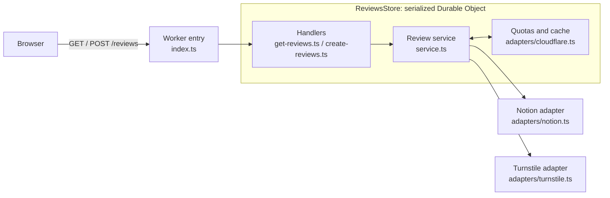

# Cookii backend

A Cloudflare Workers service for the Cookii website. It provides public API endpoints while keeping external-service credentials out of the browser. Stateful operations use SQLite-backed Durable Objects.

## Structure

```text
src/
  index.ts                 Hono Worker routes, response middleware and forwarding
  config.ts                Cloudflare bindings and configuration checks
  diagnostics.ts           Structured events and request correlation
  reviews/
    model.ts               Review outcomes and strict validation wrapper
    schema.ts              Pure Zod schemas and inferred types shared with the browser
    ports.ts               Repository, verification and state interfaces
    service.ts             List/submit use cases; no HTTP or provider APIs
    http.ts                Bounded JSON parsing and response helpers
    submission.ts          Submission validation and token mapping
    handlers/
      index.ts             Hono GET/POST routes with request-local service bindings
      get-reviews.ts       Read request handler
      create-reviews.ts    Write request handler
    adapters/
      notion.ts            Notion repository
      turnstile.ts         Challenge verification
      cloudflare.ts        Durable Object, persistent quotas and cache
scripts/deploy.ts          Deployment configuration and Wrangler runner
tests/
  reviews/                 Service and HTTP/adapter regression tests
  deployment/              Deployment tooling tests
```

Dependencies point toward the review model and ports. The service receives its adapters through interfaces; stateless parsing and validation use functions. HTTP responses stay in the handlers, HTTP helpers and Worker entry point. The Cloudflare adapter composes the service and serializes the entire use case, including quota reservation before external requests and the cache write afterward. Its object name and persistent storage keys remain stable.

The current `/reviews` endpoint supports GET (latest 20 reviews) and POST (submit a review). Turnstile verifies submissions before they are sent to Notion. The shared object persists quotas and a 60-second read cache.

## Reviews request flow



GET returns cached reviews or reads Notion. POST reserves quota and verifies Turnstile before creating a review. The Durable Object serializes quota reservations, external calls and cache updates.

## Routing and validation libraries

The Worker exports a Hono app from `src/index.ts`; Cloudflare invokes its `fetch()` entry
point. Route selection is explicit:

```text
Browser GET/POST /reviews
  -> Hono response/diagnostic middleware
  -> app.get('/reviews', ...) or app.post('/reviews', ...)
  -> forwardReviewRequest: configuration, origin, rate limits, bounded body validation
  -> env.REVIEWS.get(idFromName('reviews-v1')).fetch(completedRequest)
  -> ReviewsStore.fetch: serialized operation and dependency construction
  -> handler Hono app: GET -> handleGetReviews; POST -> handleCreateReviews
  -> ReviewService -> state / Turnstile / Notion
```

Hono's secureHeaders middleware supplies the existing explicit API policy. The small CORS
policy remains explicit so headers on successes, errors, and preflights stay compatible.
HEAD is rejected with 405 rather than Hono's default GET fallback. Unknown or encoded paths
and trailing slashes retain exact route matching. Request IDs and service dependencies live
in request-local contexts, never mutable global application fields. Unexpected errors use
our existing safe diagnostics rather than Hono's default console logger.

`src/reviews/schema.ts` contains only portable Zod schemas. The frontend imports those
schemas directly; it does not import Worker bindings or adapters. Both package manifests pin
Zod to the same version so each deployment can install independently. The frontend workflow
also runs when the shared schema changes. Backend inputs use strict objects, while browser
callers retain the previous allowance for metadata that saveReview explicitly strips out.
Schemas do not trim or coerce: raw length, blank text, control characters, rating and token
rules stay the same. Normalization still happens when saving, and Zod errors are not sent
to clients or logged with input values.

The custom 4 KB/five-second body reader deliberately stays in place before schema parsing
and Durable Object dispatch. Hono's general JSON/body-limit/timeout middleware is not a
replacement for the tested byte counting, stream cancellation, and absolute upload deadline.
Turnstile verification, persistent quotas, cache, serialization and outbound adapters are
unchanged by the routing refactor.

The Notion adapter uses the official `@notionhq/client` SDK for typed endpoint calls. Automatic retries are disabled so each reserved operation makes at most one provider request. A custom fetch preserves the eight-second abort deadline (including response bodies) and rejects redirects; SDK logging is suppressed in favor of the existing allowlisted diagnostics. Review mapping and runtime validation remain application responsibilities.

## Local development

From the repository root:

```sh
pnpm install --frozen-lockfile
cp backend/.env.example backend/.dev.vars
```

The template is named `.env.example` for consistency; Wrangler reads the copied `.dev.vars` file locally. Fill in `.dev.vars` with credentials for a development Notion integration, a separate review data source and a Turnstile widget that allows `localhost`. The Notion data source must contain `Name` (title), `Rating` (number) and `Review` (rich text). Local requests still contact Notion and Turnstile; use a separate development database to avoid publishing test reviews.

Start the Worker locally with HTTPS so the frontend's HTTPS-only API configuration accepts it:

```sh
pnpm --filter cookii-reviews-worker dev --local --local-protocol https --port 8787
```

Open `https://localhost:8787/reviews` in the browser and trust Wrangler's local development certificate. In the frontend's `.env.local`, set:

```dotenv
NEXT_PUBLIC_REVIEWS_ENABLED=true
NEXT_PUBLIC_REVIEWS_API_URL=https://localhost:8787
NEXT_PUBLIC_TURNSTILE_SITE_KEY=your-development-public-site-key
```

Run `pnpm run dev` from the repository root and open `http://localhost:3000`. Local Durable Object state is stored under `.wrangler/`; deleting that directory resets local quotas and cache.

## Configuration

| Setting                 | Purpose                                                 |
| ----------------------- | ------------------------------------------------------- |
| `ALLOWED_ORIGIN`        | Exact frontend origin, without a path or trailing slash |
| `TURNSTILE_HOSTNAME`    | Expected website hostname for verification              |
| `NOTION_DATA_SOURCE_ID` | Fixed review data source                                |
| `SUBMISSIONS_ENABLED`   | Set `true` to accept submissions; defaults to `false`   |
| `NOTION_TOKEN`          | Private Notion integration token                        |
| `TURNSTILE_SECRET`      | Private Turnstile verification key                      |
| `IP_HASH_SECRET`        | Random secret of at least 32 bytes for daily IP hashing |

For manual deployment, non-secret settings belong in `wrangler.jsonc` and private credentials are set with `pnpm exec wrangler secret put <NAME>` from `backend/`. Use the ignored `.dev.vars` file locally. The GitHub pipeline supplies production values from repository settings as described below.

## Limits and deployment

The shared object allows 3 valid-shaped verification attempts per IP per fixed hour and at most 1,000 attempts per UTC day across all IPs. Failed verification consumes these attempt limits, but not the separate 100 verified submission reservations per UTC day. Notion failures consume a verified reservation because the write may have succeeded. The attempt cap is an intentional availability/cost tradeoff: a distributed attack can still exhaust it. Before object dispatch, Cloudflare rate-limit bindings throttle GET to approximately 60 requests per IP per minute and POST to 10, per Cloudflare location. These edge limits are approximate; the object enforces strict persistent quotas. Reads refresh at most once per minute, with a 1,440-attempt daily cap. Existing stale cache can be served when the read allowance is exhausted.

```sh
pnpm --filter cookii-reviews-worker check
pnpm --filter cookii-reviews-worker deploy
```

Deployment requires Cloudflare authentication. Keep the Durable Object name/binding stable to preserve production state. Keep the account on Workers Free to use its hard free quotas; exhausted account-wide Worker or Durable Object allowances can interrupt service. The configuration cannot enforce the account's billing plan. Set `SUBMISSIONS_ENABLED=false` and redeploy to pause submissions.

Run `pnpm --filter cookii-reviews-worker typecheck` for strict Worker/deployment TypeScript checks and `pnpm --filter cookii-reviews-worker test` for the backend Playwright regression project. Live integration checks require the configured services; mocked tests do not verify deployed permissions or availability.

## Troubleshooting requests

After deployment, run `curl -i https://api.cookii-au.workers.dev/reviews -H 'Origin: https://cookii.au'`. Copy the returned `X-Request-Id`, then find the matching `requestId` in **Cloudflare → Workers & Pages → api → Observability → Logs**. Worker and Durable Object events share that ID, including failures. The Worker generates a fresh ID for every request and replaces client-supplied IDs.

| Event                                                                          | Meaning                                                                                                                          |
| ------------------------------------------------------------------------------ | -------------------------------------------------------------------------------------------------------------------------------- |
| `reviews_configuration_missing`                                                | Lists missing setting names only; check GitHub configuration and redeploy                                                        |
| `reviews_submissions_paused`                                                   | `SUBMISSIONS_ENABLED` is not `true`                                                                                              |
| `reviews_binding_missing`, `reviews_dispatch_failed`, `reviews_store_failed`   | Missing Durable Object binding, failed dispatch, or failed object concurrency boundary                                           |
| `reviews_storage_failed`                                                       | Identifies `get`/`put` and `cache`/`budget`, without stored values                                                               |
| `reviews_edge_rate_limited`, `reviews_cache_checked`, `reviews_quota_rejected` | Cache state or the quota that prevented an upstream request                                                                      |
| `notion_transport_failed`                                                      | Query/create transport error; includes a fixed error category and duration                                                       |
| `notion_request_failed`                                                        | Query/create HTTP status, allowlisted Notion error code and duration; 401: token, 403: permissions, 404: source ID or connection |
| `notion_request_completed`, `notion_response_invalid`                          | Notion HTTP success, followed by JSON/results/page validation failure if processing fails                                        |
| `notion_reviews_loaded`                                                        | Counts accepted and skipped rows; skipped rows may not match the expected review schema                                          |
| `turnstile_failed`, `turnstile_rejected`                                       | Verification service failure or challenge/hostname/action mismatch; challenge rejections include allowlisted `codes`             |
| `reviews_read_failed`, `reviews_create_failed`, `reviews_route_failed`         | Final failure boundary; inspect earlier events with the same request ID                                                          |
| `reviews_request_completed`                                                    | GET/POST response status and total Worker duration                                                                               |

Application logs contain fixed event names, generated request IDs, setting names, numeric timings/statuses/counts and allowlisted categories. They exclude tokens, IPs and their hashes, review contents, Notion IDs, URLs, raw exceptions, headers and upstream response bodies. Unknown Notion and Turnstile error codes become `unknown`; public error bodies remain generic. Logging adds events to the existing Workers Logs service, with its account retention/ingestion limits; existing request and submission quotas remain in force. Rate-limit bindings are declared in wrangler.jsonc and must be deployed with the Worker. Their counters use the connecting IP; application logs do not record it.

For a review rejected after the widget shows success, include **Info** events in the
Cloudflare log view. Find `turnstile_rejected` and correlate it with
`reviews_request_completed` using `requestId`. A `reason` of `challenge` means
Siteverify rejected the token before the hostname/action checks or the Notion save.
The `codes` field distinguishes these cases:

| Code                                               | What to check                                                                                                                                                                              |
| -------------------------------------------------- | ------------------------------------------------------------------------------------------------------------------------------------------------------------------------------------------ |
| `invalid-input-secret`, `missing-input-secret`     | Check the GitHub `TURNSTILE_SECRET` secret against the Cloudflare widget used for `NEXT_PUBLIC_TURNSTILE_SITE_KEY`, then redeploy the backend. Never paste the secret into logs or issues. |
| `timeout-or-duplicate`                             | The token expired or was already redeemed. Use a fresh verification for a new submission.                                                                                                  |
| `invalid-input-response`, `missing-input-response` | Check the submitted token and that frontend and backend use the same Turnstile widget's key pair.                                                                                          |
| `bad-request`, `internal-error`, `unknown`         | Check request construction or provider availability; unknown, absent and malformed codes are deliberately redacted.                                                                        |

The widget runs on page load and resets after each attempted submission because tokens
are intended for one use. Failed verification still consumes the submission-attempt
allowance (three attempts per IP per clock hour), so repeated retries can then return 429. The new diagnostic fields do not change verification or quota enforcement.
See [Cloudflare's Siteverify error reference](https://developers.cloudflare.com/turnstile/get-started/server-side-validation/#error-codes-reference).

## GitHub deployment

The `Deploy backend to Cloudflare Workers` workflow runs backend tests, typechecks, audit and bundle validation on pull requests. Pushes/merges to `main` and manual dispatch also deploy the backend after these checks pass. Deployments are serialized rather than cancelled mid-upload. The frontend workflow can wait for a successful backend push deployment before publishing the website.

Configure these in **Repository Settings → Secrets and variables → Actions**:

| Type               | Names                                                                                                                |
| ------------------ | -------------------------------------------------------------------------------------------------------------------- |
| Secrets            | `CLOUDFLARE_API_TOKEN`, `NOTION_TOKEN`, `TURNSTILE_SECRET`, `IP_HASH_SECRET`                                         |
| Variables          | `CLOUDFLARE_ACCOUNT_ID`, `ALLOWED_ORIGIN`, `TURNSTILE_HOSTNAME`, `NOTION_DATA_SOURCE_ID`, `SUBMISSIONS_ENABLED`      |
| Frontend variables | `NEXT_PUBLIC_REVIEWS_ENABLED` (defaults to `false`), `NEXT_PUBLIC_REVIEWS_API_URL`, `NEXT_PUBLIC_TURNSTILE_SITE_KEY` |

Use a Cloudflare API token scoped to the intended account with permission to deploy Workers (the Edit Cloudflare Workers template is a starting point). The account ID is the 32-character value in the Cloudflare dashboard. Use a Workers Free account; deployment code cannot enforce the billing plan.

`deploy:ci` validates configuration, passes non-secret variables as Wrangler overrides, and uploads the three application secrets with the Worker version using a restricted temporary JSON file that is removed afterward. Missing credentials fail deployment; `SUBMISSIONS_ENABLED` defaults to `false`. The GitHub variable becomes the source of truth for that switch, so change it before rerunning the workflow to pause submissions. Existing Worker secrets are not required for the first deployment.

Use the base URL `https://cookii-reviews.<your-workers-subdomain>.workers.dev` for the frontend variable; the frontend appends `/reviews` in code. Activate your account's workers.dev subdomain before the first deployment. The workflow does not create Notion integrations or Turnstile widgets, choose the account plan, or configure GitHub repository settings.

## Request and injection protections

POST uploads are read at the public Worker after request throttling and before dispatch to
`reviews-v1`. A submission must finish within a single five-second deadline and contain at
most 4,096 actual bytes, even if Content-Length is missing or incorrect. Unsupported media
or content encodings return 415; excess size returns 413; a stalled body returns 408;
malformed JSON, invalid UTF-8, aborted uploads, and invalid fields return 400. Errors expose
only a generic message. `reviews_request_rejected` records the status without request data.

The Worker validates the submission and forwards a completed JSON body, so a client that
trickles upload bytes cannot hold the shared Durable Object's serialization boundary. The
handler also uses the bounded reader as defence in depth. Stream cancellation is best-effort
and is never awaited on rejection. The five-second deadline may reject unusually slow
connections; this endpoint accepts only a small text review. This is application-layer
protection, not a replacement for platform DDoS controls or a total request-duration limit.

Review strings remain plain text. Tests cover HTML event handlers, SVG, iframe breakouts,
encoded markup, javascript URLs, and SQL-shaped input through the actual Notion adapter
and browser review components. Notion writes use fixed endpoints and structured JSON; no
SQL statements are constructed from user input. SQL-shaped text is allowed as harmless
review content. Any future SQL integration must use parameterized queries, and rich HTML
would require a dedicated sanitization design before enabling it.

The `Security analysis` workflow runs CodeQL's `security-extended` JavaScript/TypeScript
suite on PRs, main, and weekly. It scans frontend, backend, shared UI components, and
application scripts for supported injection and other security data-flow patterns. The
action is pinned to a commit and does not receive deployment secrets. Findings appear in
GitHub code scanning; a completed analysis is not proof of no vulnerabilities. Configure
repository rules to require code-scanning results before merge if enforcement is desired;
this PR does not change branch protection or deploy a managed WAF. CodeQL reports source
risks; it does not filter live requests.

References: [OWASP DoS guidance](https://cheatsheetseries.owasp.org/cheatsheets/Denial_of_Service_Cheat_Sheet.html),
[GitHub's JavaScript/TypeScript security queries](https://docs.github.com/en/code-security/reference/code-scanning/codeql/codeql-queries/javascript-typescript-built-in-queries).
