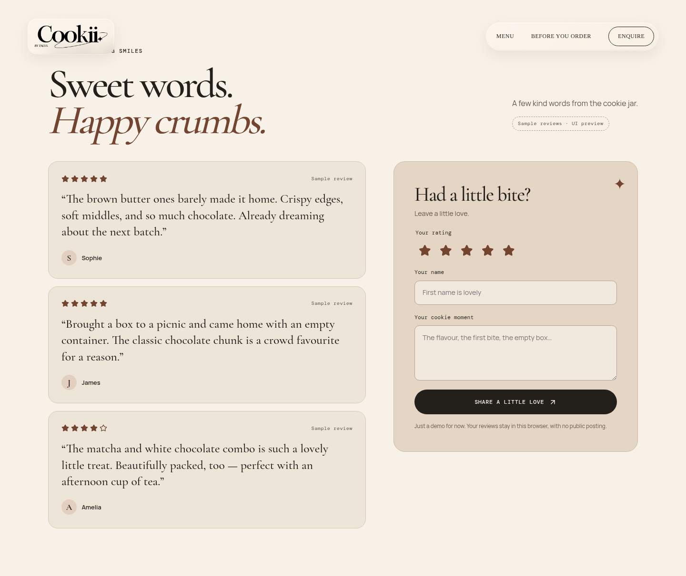
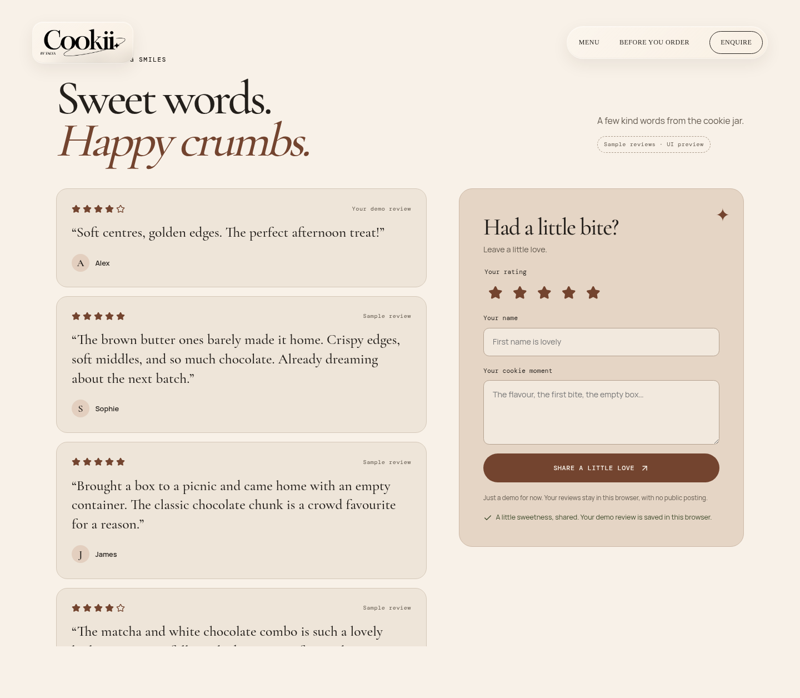
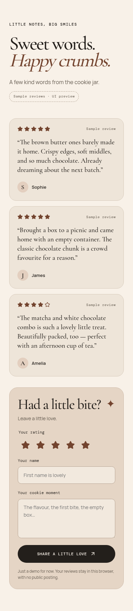
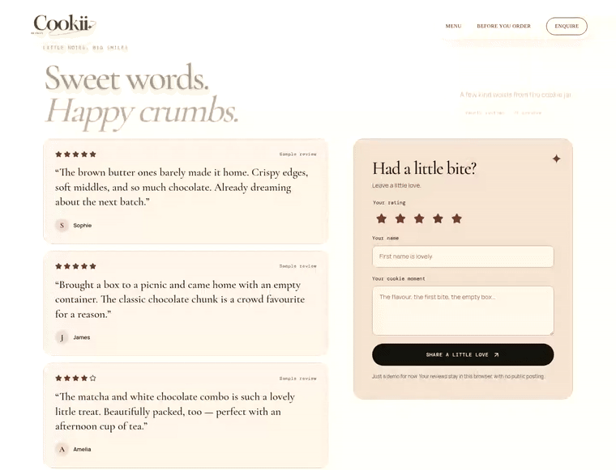

# Review section preview

An interactive demo above the footer: three clearly labelled sample reviews, a star rating picker, and a review form. New cards animate into the list; stars and cards respond to hover. The layout stacks on mobile and respects reduced-motion preferences.

Submitted reviews are stored only in this browser using `cookii-demo-reviews-v1` in local storage (up to 20 entries). They are not sent to a server or shared with other visitors. If browser storage is blocked, submissions work for the current visit. Shared persistence can be added later.

## Screenshots and animation

[Watch the interaction video](interaction.mp4)

## Validation

- `npm run build`: production static export and TypeScript passed.
- `npm run lint`: passed.
- Chromium browser checks: initial sample cards, required/whitespace validation, keyboard star selection, submission, form reset, and persistence after refresh.
- Corrupt data and invalid stored entries fall back to samples. Blocked storage still permits an in-memory submission.
- Desktop (1440 px) and mobile (390 px), no mobile horizontal overflow, reduced-motion animation override, and no browser runtime errors.

To try it: run `npm run dev`, scroll to the section above the footer, choose stars, enter a name and review, and submit. Refresh to confirm browser persistence. To reset, remove `cookii-demo-reviews-v1` from this site's local storage in browser developer tools.
